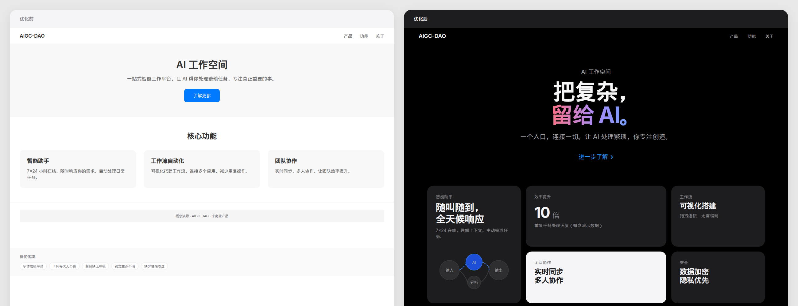

# Apple-inspired 视觉美学｜AIGC-DAO 出品

一套适用于 Codex 等 AI 助手的视觉设计与前端工程 Skill，将构图、留白、光影、材质、排版、组件规范转为可执行方法。适用于产品精修、海报设计、UI/前端开发和图像编辑提示词。

**核心是：提升呈现，保留产品本真；先理解项目，再落实设计。**

出品与维护：AIGC-DAO

本项目由 AIGC-DAO 制作与维护，非 Apple 官方项目，与 Apple 无隶属或合作关系。

---

## 效果对比



*左：优化前（字体层级平淡、卡片等大无节奏）→ 右：优化后（巨大字体对比、Bento 错落、黑白灰层次、有限渐变焦点）*

**After 单独视图**：[查看大图](docs/images/after-v2.png)

---

## 安装

将本仓库的 `SKILL.md` 及 `references/` 目录添加到 AI 助手的 skills 目录。

```
your-skills-directory/
├── apple-inspired/
│   ├── SKILL.md          # 入口文件（必须）
│   └── references/       # 参考文档（按需加载）
│       ├── ui-foundations.md
│       ├── components.md
│       ├── motion-glass.md
│       ├── responsive-a11y.md
│       ├── photography.md
│       └── workflow.md
```

本仓库提供 Skill 文件、设计令牌示例和参考文档，不包含图像生成或编辑工具。实际改图需要所在环境本身具备相应能力。

---

## 使用

在对话中说"使用 apple-inspired skill"触发。

### 新建页面
> 使用 apple-inspired skill，为这个 React 项目创建一个产品详情页。先阅读现有代码结构和样式惯例。

### 改进组件
> 使用 apple-inspired skill，审查并改进这个按钮组件的状态覆盖和无障碍。

### 审查页面
> 使用 apple-inspired skill，审查这个页面的视觉层级、间距一致性和响应式表现。

### 产品摄影提示词
> 使用 apple-inspired skill，为这张产品图写 Flux 精修提示词，保留结构和配色。

---

## 覆盖范围

| 领域 | 说明 |
|-----|------|
| UI/前端开发 | 设计令牌、组件规范、状态覆盖、无障碍 |
| 响应式与暗色 | 内容驱动断点、暗色模式、reduced-motion |
| 动效与玻璃拟态 | 克制时长、回退方案、对比度保证 |
| 产品摄影 | 保真改图、提示词模板、交付检查 |

详细原则和实现方法见 `SKILL.md` 及 `references/` 目录。

---

## 示例文件

- `examples/tokens.css` — 可复用的 CSS 设计令牌（框架无关）
- `examples/demo.html` — 可交互的组件演示页面
- `docs/before-after.html` — 对比图源文件

---

## 不做什么

- ❌ 不假定 SF Pro/SF Mono 可自由下载分发
- ❌ 不伪称数值是 Apple 官方规范
- ❌ 不擅自重写项目架构或换框架
- ❌ 不虚构业务数据、用户评价或合作背书
- ❌ 不模仿 Apple 官网或暗示官方关系
